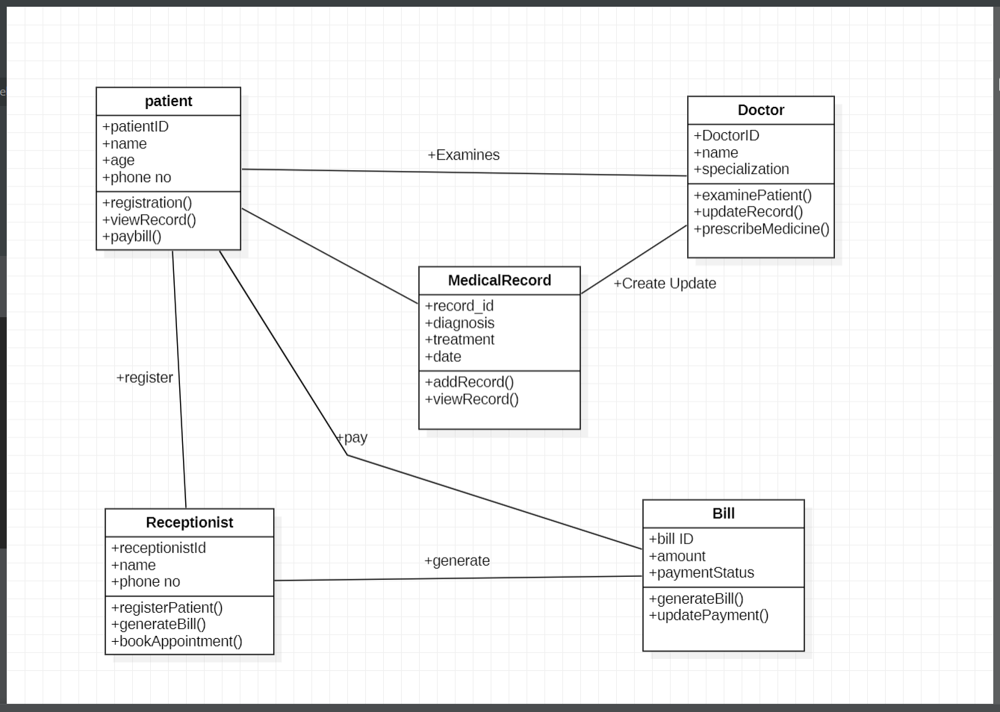
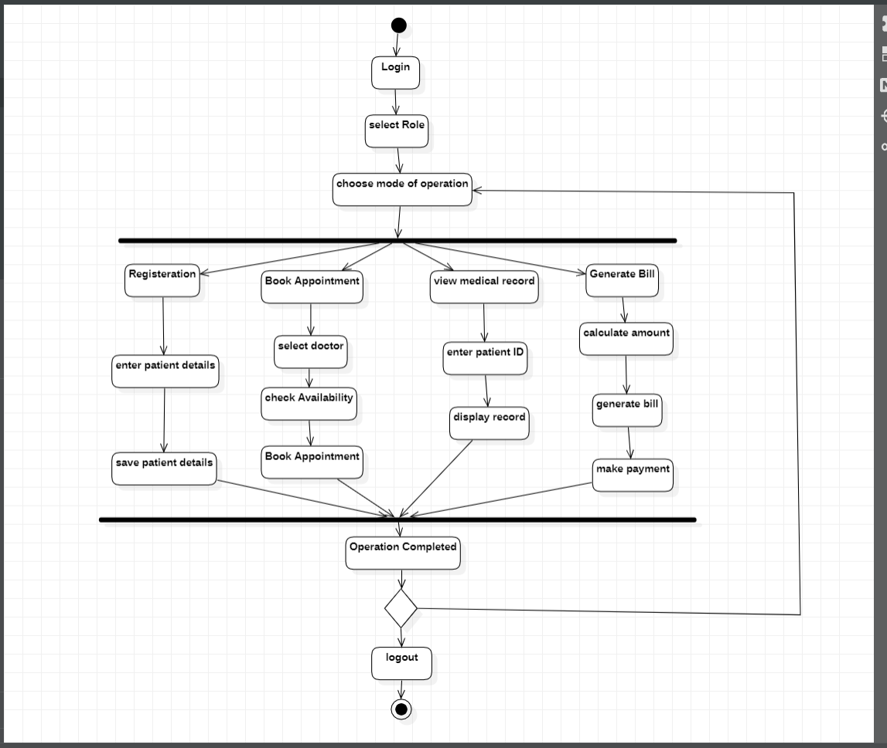
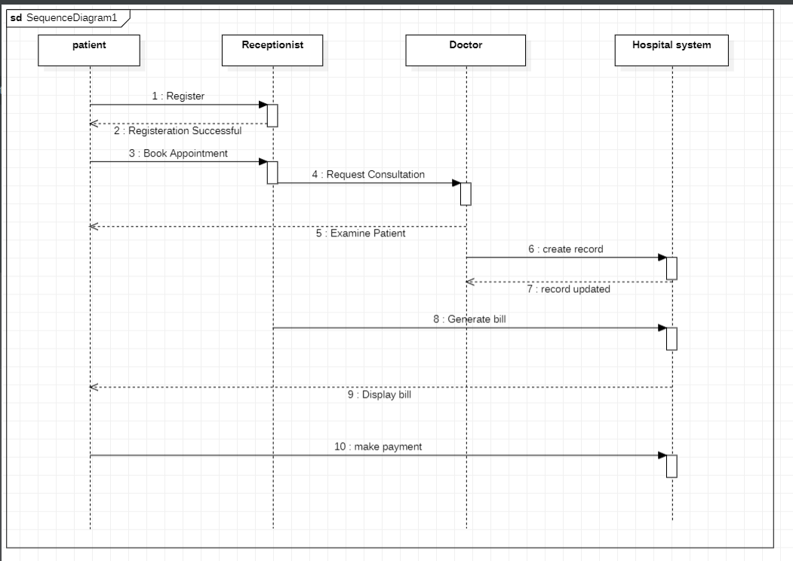
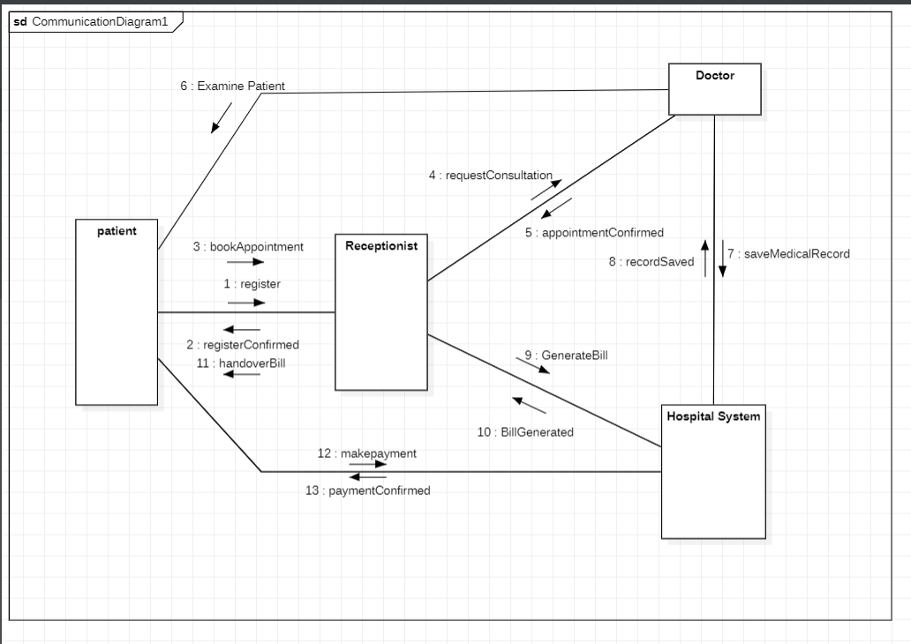
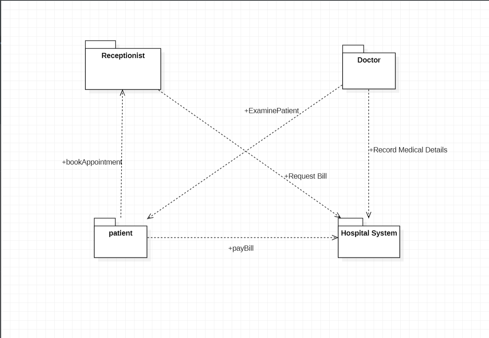

# EXP – 4: HOSPITAL MANAGEMENT SYSTEM

## AIM:

To design and develop UML diagrams for a Hospital Management System to represent its structure, functions, and interactions between the patient, doctor, receptionist, and hospital system.

## SRS (Procedure):

### Step 1: Problem Identification

The main problem is the difficulty of manually managing patient details, appointments, medical records, and billing. A Hospital Management System helps automate these activities efficiently.

### Step 2: Requirement Analysis

Identify the main users: Patient, Doctor, and Receptionist.

**Functional Requirements:**

1. Patient registration and login.
2. Book and manage appointments.
3. Doctor examines patients and provides treatment.
4. Doctor saves medical records in the hospital system.
5. Receptionist manages patient details and appointments.
6. Receptionist enters billing details and requests bill generation.
7. Hospital System generates bills and processes payments.

**Non-Functional Requirements:**

1. Security
2. Reliability
3. Accuracy
4. User-friendliness
5. Fast response time

### Step 3: System Design

Draw the following UML diagrams to represent the system:

1. Use Case Diagram
2. Class Diagram
3. Activity Diagram
4. Sequence Diagram
5. Communication Diagram
6. Package Diagram

# DIAGRAMS:

## Use Case Diagram

## Class Diagram

## Activity Diagram

## Sequence Diagram

## Communication Diagram

## Package Diagram

# RESULT:

Thus, the six UML diagrams for the Hospital Management System were designed successfully to represent its structure, functionality, and interactions between the patient, doctor, receptionist, and hospital system.
